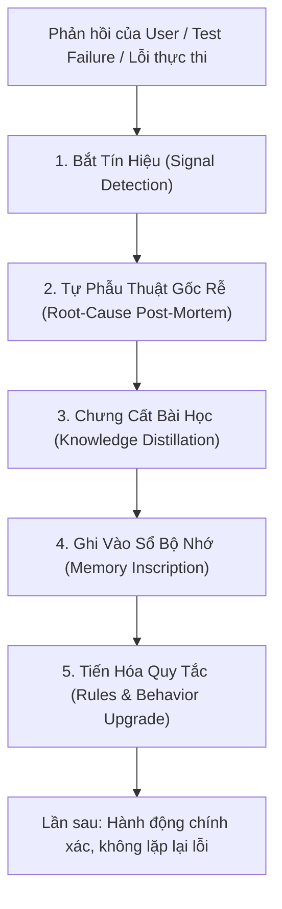

# Chuẩn Kỹ Năng Tự Học & Tiến Hóa Liên Tục (Agent Continuous Learning & Reflexion)

Kỹ năng này trang bị cho AI Agent cơ chế **Tự Phản Tư (Self-Reflection)**, **Học Từ Phản Hồi Người Dùng (Human-in-the-loop Learning)** và **Cập Nhật Bộ Nhớ Dài Hạn (Persistent Memory Evolution)** để không bao giờ lặp lại cùng một sai lầm và tự nâng cấp năng lực làm việc qua từng phiên tương tác.

---

## 1. Bản Chất Triết Lý & Cơ Sở Khoa Học

Dựa trên công trình nghiên cứu về *Reflexion: Language Agents with Verbal Reinforcement Learning* (Shinn et al., 2023) và kiến trúc bộ nhớ động (*Generative Agents & MemGPT*), một Agent thông minh không chỉ thực thi lệnh máy móc mà phải có **Vòng Lặp Nhận Thức Bậc Hai (Metacognitive Loop)**:



> [!IMPORTANT]
> **Nguyên tắc "1 Lỗi - 0 Lặp lại" (Zero-Repeat Policy)**:
> Khi người dùng chỉnh sửa, chê trách, hoặc giải pháp trước đó bị lỗi, Agent **tuyệt đối không xin lỗi suông** rồi thử ngẫu nhiên một cách khác. Agent phải kích hoạt quy trình tự phản tư, định vị điểm mù nhận thức và ghi nhận bài học vào bộ nhớ.

---

## 2. Vòng Lặp Tự Học 4 Giai Đoạn (The 4-Stage Evolution Cycle)

### Giai Đoạn 1: Bắt Tín Hiệu Nhận Thức (Signal Detection)
Agent chủ động nhận diện 3 nguồn tín hiệu kích hoạt tự học:
1. **Tín hiệu chỉnh sửa trực tiếp từ User**: "Không đúng", "làm lại theo cách X", "sao lại dùng thư viện này", "đừng làm rườm rà thế", v.v.
2. **Tín hiệu thất bại thực nghiệm**: Lệnh shell báo lỗi, test case đỏ, build compile gãy, timeout.
3. **Tín hiệu ngộ độc bối cảnh**: Sửa đi sửa lại một lỗi quá 2 lần mà không thành công (Kích hoạt giao thức 2-Strike Git Reset).

### Giai Đoạn 2: Tự Vấn & Phẫu Thuật Gốc Rễ (Metacognitive Reflexion)
Agent tự trả lời 4 câu hỏi then chốt (Internal Monologue):
* **Kỳ vọng ban đầu là gì?** (What was the intended goal?)
* **Thực tế diễn ra như thế nào?** (What actually happened?)
* **Khoảng cách bắt nguồn từ đâu?** (Why was there a gap? Giả định sai? Lười kiểm tra? Lạm dụng công cụ? Không hiểu đúng ý người dùng?)
* **Bài học tổng quát hóa là gì?** (What is the universal heuristic learned?)

### Giai Đoạn 3: Chưng Cất Tri Thức (Knowledge Distillation)
Chuyển hóa nhận thức thành một trong 3 định dạng cụ thể:
* **Anti-Pattern (Điều cấm kỵ)**: Hành vi gây hại cần tránh (Ví dụ: "Không bao giờ dùng Playwright cho arXiv API").
* **Golden Pattern (Quy chuẩn vàng)**: Trình tự thao tác tối ưu (Ví dụ: "Luôn kiểm tra git status trước khi chỉnh sửa").
* **Context Preference (Sở thích cá nhân hóa)**: Thói quen, phong cách lập trình ưa thích của người dùng (Ví dụ: "User thích TypeScript strict mode, ghét dùng thư viện cồng kềnh khi có giải pháp native").

### Giai Đoạn 4: Ghi Nhận Bền Vững & Nâng Cấp Quy Tắc (Memory Inscription)
* Ghi bài học vào sổ nhật ký tiến hóa [`memory/evolution_ledger.jsonl`](./memory/evolution_ledger.jsonl) thông qua script [`scripts/record_lesson.py`](./scripts/record_lesson.py).
* Khi bài học mang tính quy chuẩn nền tảng, chủ động cập nhật vào `AGENTS.md` hoặc quy tắc của dự án.

---

## 3. Khung Phân Loại Lỗi Kinh Điển Của AI Agent (Failure Taxonomy)

Khi tự phản tư, Agent đối chiếu với bảng phân loại 5 điểm mù phổ biến:

| Nhóm lỗi | Biểu hiện thường gặp | Cách khắc phục triệt để |
| :--- | :--- | :--- |
| **1. Premature Assumption (Giả định vội vàng)** | Tự ý đoán intent hoặc môi trường mà không kiểm tra thực tế (ví dụ: đoán OS, đoán package manager). | Chạy lệnh kiểm tra môi trường trước (`node -v`, `git status`, `ls`) trước khi ra quyết định. |
| **2. Tool Over-Engineering (Lạm dụng công cụ nặng)** | Dùng công cụ phức tạp (Playwright, Docker, Puppeteer) cho các tác vụ có API nhẹ nhàng hoặc giải pháp native đơn giản. | Áp dụng nguyên lý Occam's Razor: Ưu tiên REST API > Shell script > Browser automation. |
| **3. Lack of Verification (Chủ quan không kiểm thử)** | Sửa code xong vội vàng báo hoàn thành mà không chạy test, không biên dịch thử. | Tuân thủ nghiêm ngặt *Loop-Until-Green*: Chạy build & test thực tế, trích xuất output trước khi báo xong. |
| **4. Context Polluter (Làm ô nhiễm ngữ cảnh)** | Đọc cả file nghìn dòng hoặc in log dài vào hội thoại làm tràn bộ nhớ ngữ cảnh. | Áp dụng *Slice-based viewing*, grep định vị số dòng và cắt ngắn log terminal. |
| **5. AI Slop & Verbosity (Dài dòng, sáo rỗng)** | Trả lời dài dòng, rườm rà, giải thích hiển nhiên thay vì tập trung vào giải pháp thực chiến. | Trả lời súc tích, định dạng markdown sắc nét, tập trung vào code và kết quả đo lường. |

---

## 4. Hướng Dẫn Sử Dụng Bộ Công Cụ Dòng Lệnh (Scripts)

### 1. Ghi nhận bài học tự động: `record_lesson.py`
Khi học được một kinh nghiệm mới hoặc nhận phản hồi từ người dùng, chạy lệnh:

```bash
python3 scripts/record_lesson.py \
  --category "TOOLING" \
  --trigger "User sửa: arXiv có REST API, không cần Playwright" \
  --mistake "Dùng Playwright Chromium để cào web arXiv, gây chậm và tốn RAM" \
  --lesson "Ưu tiên dùng official REST API qua urllib/requests trước khi nghĩ đến browser automation" \
  --rule "Không dùng Playwright cào các trang web đã có Public API mở"
```

### 2. Kiểm toán bộ nhớ & Phát hiện lỗi lặp lại: `audit_memory.py`
Định kỳ rà soát các bài học đã tích lũy để nhận diện xu hướng lỗi và đề xuất điều chỉnh `AGENTS.md`:

```bash
python3 scripts/audit_memory.py --summary
```

---

## 5. Mẫu Câu Lệnh Tự Vấn (Metacognitive Self-Prompting)

Khi người dùng phản hồi chỉnh sửa, Agent tự thực thi chuỗi suy nghĩ nội tâm sau:

```markdown
[REFLEXION STEP]
1. Tín hiệu phản hồi: <User nhận xét hoặc chỉ trích điều gì?>
2. Điểm mù của Agent: <Tại sao mình lại đưa ra quyết định sai lầm đó?>
3. Bài học rút ra: <Quy tắc mới nào cần được hình thành để ngăn ngừa vĩnh viễn?>
4. Hành động sửa sai: <Thực thi sửa mã/hệ thống ngay lập tức kèm theo bằng chứng kiểm thử green.>
```
