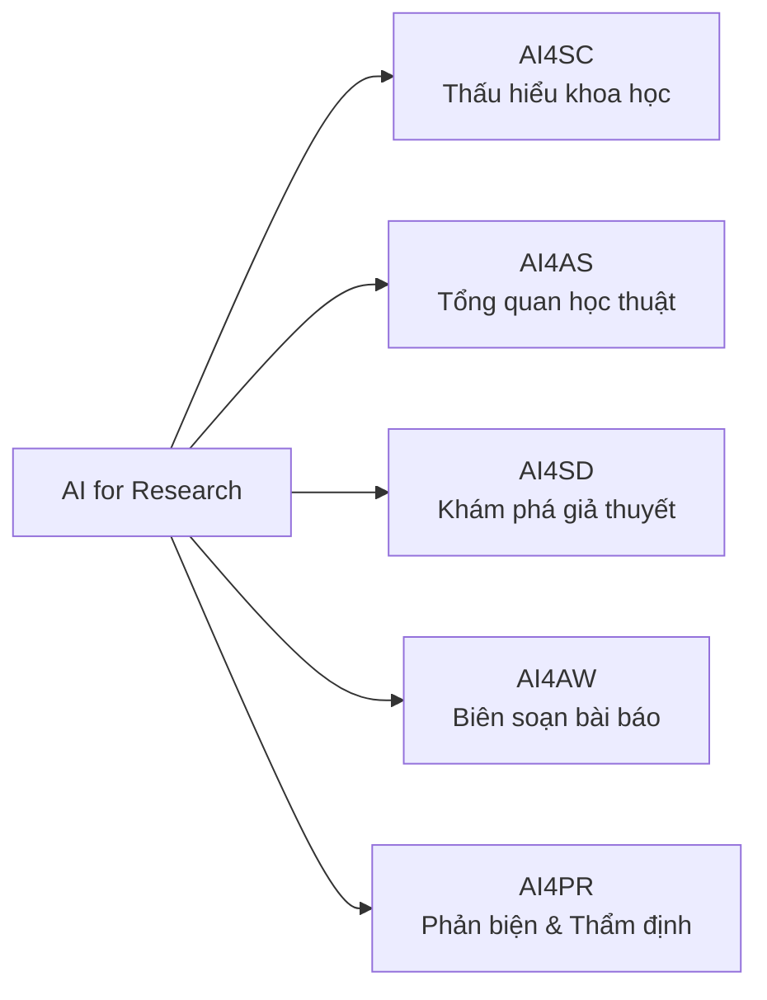

# Chuẩn Kỹ Năng Toàn Diện: Nghiên Cứu Khoa Học, Cào Dữ Liệu Tự Động & Dịch Thuật LaTeX Chuẩn (AI-Research-Pro)

Tài liệu này là cẩm nang tích hợp duy nhất (**Consolidated Master Skill**) hướng dẫn toàn bộ quy trình, phương pháp luận và kỹ thuật tự động hóa để biến AI thành một **Nhà Nghiên Cứu Học Thuật Độc Lập, Trợ Lý Thu Thập Dữ Liệu & Chuyên Gia Dịch Thuật Khoa Học Sang LaTeX Chuẩn**.

---

## MỤC LỤC TỔNG HỢP

1. [Khung Phân Loại AI4Research (5 Trụ Cột)](#1-khung-phân-loại-ai4research-5-trụ-cột)
2. [Quy Trình Deep Research 5 Giai Đoạn](#2-quy-trình-deep-research-5-giai-đoạn)
3. [Quy Chuẩn Dịch Thuật Học Thuật Sang Tiếng Việt & Xuất Bản LaTeX](#3-quy-chuẩn-dịch-thuật-học-thuật-sang-tiếng-việt--xuất-bản-latex)
4. [Mẫu Câu Lệnh (Prompt Scaffolds) Chuẩn Học Thuật & Sư Phạm](#4-mẫu-câu-lệnh-prompt-scaffolds-chuẩn-học-thuật--sư-phạm)
5. [Bộ Tiêu Chuẩn 8 Lăng Kính Phản Biện (Evaluative Lenses)](#5-bộ-tiêu-chuẩn-8-lăng-kính-phản-biện-evaluative-lenses)
6. [Hướng Dẫn Sử Dụng Bộ Kịch Bản Tự Động (Scripts)](#6-hướng-dẫn-sử-dụng-bộ-kịch-bản-tự-động-scripts)
7. [Khung Quy Chuẩn Sư Phạm Nhận Thức & Thiết Kế Tài Liệu Tự Học Cùng AI](#7-khung-quy-chuẩn-sư-phạm-nhận-thức--thiết-kế-tài-liệu-tự-học-cùng-ai)

---

## 1. Khung Phân Loại AI4Research (5 Trụ Cột)

Dựa trên công trình khảo sát chuẩn hóa (*Sci. China Inf. Sci. 2026* & *arXiv:2501.04306*), mọi tác vụ học thuật được phân định vào 5 trụ cột:



1. **AI4SC (Scientific Comprehension)**: Đọc hiểu sâu các bài báo phức tạp, giải mã công thức toán, cấu trúc dữ liệu và logic chứng minh.
2. **AI4AS (Academic Survey / Literature Review)**: Tự động hóa rà soát tài liệu có hệ thống, truy hồi đa nguồn (arXiv, PubMed, Semantic Scholar) và phân loại ma trận tri thức.
3. **AI4SD (Scientific Discovery)**: Phát hiện khoảng trống nghiên cứu (Research Gaps), liên kết tri thức chéo lĩnh vực (Swanson ABC model) và sinh giả thuyết khoa học mới.
4. **AI4AW (Academic Writing)**: Biên soạn báo cáo khoa học đa tầng, tổng quan tài liệu theo cấu trúc chuẩn mực IMRAD hoặc mã nguồn LaTeX.
5. **AI4PR (Peer Reviewing & Fact-Checking)**: Đối chiếu chéo luận điểm, phát hiện ảo giác trích dẫn (Hallucination detection) và đánh giá độ tin cậy của phát hiện thực nghiệm.

---

## 2. Quy Trình Deep Research 5 Giai Đoạn

Khi thực hiện nghiên cứu bất kỳ đề tài học thuật nào:

### Giai Đoạn 1: Phân Rã Chủ Đề & Đa Góc Nhìn (Stanford STORM Framing)
* Không tìm kiếm bằng từ khóa đơn lẻ. Bắt buộc phân rã chủ đề thành các câu hỏi nghiên cứu đa góc nhìn (Góc nhìn thuật toán, góc nhìn sư phạm/người dùng, góc nhìn kỹ sư thực nghiệm, góc nhìn phản biện rủi ro).
* Tạo danh sách các cặp từ khóa tìm kiếm Boolean kết hợp (AND, OR, NOT) và giới hạn năm phát hành (ưu tiên năm mới nhất).

### Giai Đoạn 2: Thu Thập Tự Động Bằng Playwright & SciSpace (Automated Crawling)
* **Thu thập đa nguồn kết hợp (Hybrid Crawling)**: Sử dụng Playwright (Chromium) để cào dữ liệu thực tế từ cả **SciSpace** (`https://scispace.com/`) và **arXiv** (`https://arxiv.org/`), tận dụng thế mạnh của từng nền tảng:
  * **SciSpace**: Khai thác tổng quan tri thức chéo (AI cross-paper synthesis), trích dẫn thực tế (citation counts), tóm lược mấu chốt (TLDR), và ma trận thuộc tính phương pháp/kết quả.
  * **arXiv**: Thu thập bài báo mới nhất (preprints năm hiện tại), tóm tắt đầy đủ và mã nguồn mở.
* **Cơ chế vượt rào cản phòng vệ (Anti-WAF Stealth Protocol)**: SciSpace được bảo vệ bởi AWS WAF Bot Control. Khi tự động hóa bằng Playwright, bắt buộc kích hoạt cờ stealth:
  * Khởi tạo trình duyệt với `--disable-blink-features=AutomationControlled` và `--no-sandbox`.
  * Ghi đè `navigator.webdriver = undefined`, tiêm đối tượng `window.chrome = { runtime: {} }`.
* **Quản lý phiên đăng nhập SciSpace bền vững (Persistent Session Management)**:
  * SciSpace áp dụng giới hạn nghiêm ngặt với khách vãng lai (Guest Limit). Để truy xuất không giới hạn toàn bộ kết quả Literature Review và AI Insights, công cụ hỗ trợ lệnh `scispace_crawler.py --login`.
  * Lệnh này mở cửa sổ trình duyệt trực quan để người dùng đăng nhập 1 lần duy nhất; Playwright tự động bắt JWT token `__Host-access` và lưu trạng thái vào `~/.config/scispace_session.json` để mọi lần quét sau đều chạy ngầm (headless) trơn tru 100%.
* **Tiêu chuẩn dữ liệu**: Mỗi công trình thu thập phải lưu trữ tối thiểu: `title`, `authors`, `year`, `citations`, `link` (URL SciSpace hoặc arXiv/DOI), `pdf_url` và `abstract`/`tldr`. Dữ liệu thô lưu vào `data/papers.json`.

### Giai Đoạn 3: Neo Dẫn Chứng & Triệt Tiêu Ảo Giác (PaperQA2 Grounding)
* **Nguyên tắc "No Free Claims"**: Tuyệt đối không phát biểu một khẳng định thực nghiệm mà không kèm theo liên kết định danh bài báo cụ thể (`https://arxiv.org/abs/...` hoặc DOI).
* Loại bỏ 100% hiện tượng trích dẫn giả mạo (Zero Citation Hallucination).

### Giai Đoạn 4: Tổng Hợp Ma Trận Tri Thức & Nhận Diện Khoảng Trống (Matrix Synthesis)
* Không tóm tắt từng bài rời rạc. Tổng hợp theo cụm chủ đề (Thematic Clustering) và lập ma trận đối sánh:
  $$\text{Phương pháp/Kiến trúc} \longleftrightarrow \text{Tập dữ liệu} \longleftrightarrow \text{Số liệu cải thiện} \longleftrightarrow \text{Hạn chế chưa giải quyết}$$
* Nêu bật các **Research Gaps** (Những gì các công trình hiện tại chưa giải quyết được).

### Giai Đoạn 5: Báo Cáo Đa Tầng (Multi-Tier Reporting)
* Cấu trúc: Tóm tắt điều hành (3 phút) $\to$ Bản đồ tư duy Mermaid $\to$ Chuyên đề chuyên sâu $\to$ Hàm ý thực hành $\to$ Tệp chỉ mục dữ liệu thô.

---

## 3. Quy Chuẩn Dịch Thuật Học Thuật Sang Tiếng Việt & Xuất Bản LaTeX

Khi dịch và soạn thảo tóm tắt bài báo khoa học bằng LaTeX, bắt buộc tuân thủ **4 tiêu chí**:

### Tiêu Chí 1: Văn phong tự nhiên, thuần Việt, LOẠI BỎ THUẬT NGỮ ĐAO TO BÚA LỚN (Anti-Jargon & Plain-Language Protocol)
* **Nguyên tắc "Tả thực hành động, cấm từ ngữ hành chính / Hán-Việt bóng bẩy" (Action-Oriented Grounding)**:
  * Khi mô tả một hiện tượng hay vấn đề: **BẮT BUỘC dùng động từ và danh từ miêu tả hành động thực tế diễn ra ngoài đời**. Tuyệt đối không dùng các từ ghép Hán-Việt hàn lâm, sáo rỗng hoặc tiếng lóng hành chính khiến người đọc khó hiểu.
  * **BẢNG QUY ĐỔI BẮT BUỘC (MẪU TỪ KHÓ HIỂU $\longrightarrow$ TỪ BÌNH DÂN RÕ NGHĨA)**:
    * ❌ *"Cốt lõi"* $\longrightarrow$ ✅ *"Chính", "quan trọng nhất"* (Ví dụ: "5 chức năng chính", "bảng dữ liệu chính", "thông điệp chính").
    * ❌ *"Đặc tả"* $\longrightarrow$ ✅ *"Mô tả chi tiết", "quy định cụ thể"* (Ví dụ: "Bản mô tả yêu cầu", "mô tả chi tiết 5 chức năng").
    * ❌ *"Trục / Trục nghiệp vụ"* $\longrightarrow$ ✅ *"Quy trình", "khâu", "mảng việc"* (Ví dụ: "Quy trình xuất cấp phát", "khâu kiểm kê").
    * ❌ *"Ma trận"* (khi chỉ là bảng) $\longrightarrow$ ✅ *"Bảng so sánh", "đối chiếu chi tiết"*.
    * ❌ *"Ánh xạ"* $\longrightarrow$ ✅ *"Dựa theo", "bám sát", "đối chiếu theo"*.
    * ❌ *"Quản trị vòng đời"* $\longrightarrow$ ✅ *"Theo dõi quá trình sử dụng từ lúc mua về đến khi thanh lý"*.
    * ❌ *"Triệt tiêu"* $\longrightarrow$ ✅ *"Xóa bỏ", "dẹp bỏ", "loại bỏ hoàn toàn"*.
    * ❌ *"Điểm nghẽn"* $\longrightarrow$ ✅ *"Khó khăn lớn", "vướng mắc lớn"*.
    * ❌ *"Chủ thể"* $\longrightarrow$ ✅ *"Phòng ban", "đơn vị", "bên liên quan"*.
    * ❌ *"Hàm ý thực hành"* $\longrightarrow$ ✅ *"Việc cần làm", "bài học rút ra"*.
    * ❌ *"Hiện tượng ghi sổ hồi tố"* $\longrightarrow$ ✅ *"Bỏ quên cả tuần không đo, cuối tuần mới lấy bút tự chép bù số liệu khống vào sổ để đối phó thanh tra"*.
    * ❌ *"Đứt gãy dây chuyền lạnh (Cold Chain) ban đêm"* $\longrightarrow$ ✅ *"Tủ lạnh bảo quản bị mất điện hoặc hỏng rơ-le ban đêm, làm vaccine và thuốc hỏng hết"*.
    * ❌ *"Xuất toán BHYT"* $\longrightarrow$ ✅ *"Bảo hiểm y tế từ chối chi trả, bệnh viện trừ tiền lương hoặc bắt điều dưỡng tự bỏ tiền túi đền"*.
    * ❌ *"Tối ưu hóa thời gian downtime"* $\longrightarrow$ ✅ *"Giảm thời gian máy móc bị hỏng phải trùm mền nằm chờ sửa"*.
    * ❌ *"Ủy thác nhận thức (Cognitive offloading)"* $\longrightarrow$ ✅ *"Ỷ lại tư duy, để AI nghĩ hộ khiến não lười suy nghĩ"*.
    * ❌ *"Lực ma sát sư phạm (Pedagogical friction)"* $\longrightarrow$ ✅ *"Tạo thử thách tư duy, chặn đưa đáp án ngay để người học tự động não"*.
    * ❌ *"Nợ nhận thức (Cognitive debt)"* $\longrightarrow$ ✅ *"Lỗ hổng kiến thức ngầm tích tụ do lạm dụng câu trả lời có sẵn"*.
    * ❌ *"Bù cơ số tủ trực"* $\longrightarrow$ ✅ *"Lấy bao nhiêu viên thuốc từ tủ cấp cứu thì phải làm phiếu xin cấp lại bấy nhiêu viên để tủ luôn đủ đồ"*.
    * ❌ *"Biệt trữ (Quarantine)"* $\longrightarrow$ ✅ *"Khu vực cách ly để riêng thuốc hỏng, thuốc hết hạn để tránh lấy nhầm"*.
* **Quy tắc "Thử nghiệm 5 giây cho người ngoài ngành (5-Second Layman Test)"**:
  * Đọc lại từng câu bằng con mắt của một sinh viên năm nhất hoặc người ngoài ngành. Nếu có bất kỳ cụm từ nào mà người đọc phải khựng lại quá 2 giây để suy nghĩ hoặc tra từ điển $\implies$ **Bắt buộc viết lại ngay lập tức bằng câu văn miêu tả hành động thực tế**.
* **Nguyên tắc "Định danh kép kèm giải thích đời thường"**:
  * Nếu bắt buộc phải nhắc thuật ngữ chuyên ngành (để làm đồ án hoặc đối soát luật): Phải kèm theo giải nghĩa bình dân ngay tại chỗ: *"Tình trạng thuốc bị hỏng do tủ lạnh trữ thuốc mất điện ban đêm (thuật ngữ chuyên môn gọi là đứt gãy dây chuyền lạnh - cold chain)..."*.
* **Bảo toàn sự thật 100%**: Dễ hiểu, bình dân nhưng **không được suy diễn hoặc bịa đặt số liệu**. Mọi con số, bối cảnh thực nghiệm và kết luận đều phải khớp chính xác với bài báo gốc.

### Tiêu Chí 2: Chắt lọc thông tin quan trọng nhất, LOẠI BỎ thông tin thừa (High-Signal, Zero-Fluff)
Mỗi bản dịch chuẩn chỉ bao gồm đúng 5 khối thông tin chính:
1. **Thông điệp mấu chốt (Core Takeaway)**: 2–3 câu tóm tắt phát hiện đắt giá nhất (dùng đoạn trích học thuật `quote` hoặc dòng kẻ mảnh, TUYỆT ĐỐI KHÔNG dùng hộp box đóng khung).
2. **Bản chất vấn đề & Thực nghiệm**: Tác giả giải quyết bài toán gì và thử nghiệm trên ai/bộ dữ liệu nào?
3. **Bản dịch chọn lọc**: Đoạn văn then chốt chuyển ngữ tự nhiên, mạch lạc, không lai tạp cú pháp tiếng Anh.
4. **Bảng tra cứu thuật ngữ bình dân**: Bảng 3 cột (Tiếng Anh - Tiếng Việt thoát ý - Giải nghĩa bản chất qua ví dụ đời thường).
5. **Bài học bỏ túi (Actionable Takeaways)**: Rút ra chính xác người đọc nên làm gì và nên tránh điều gì.

### Tiêu Chí 3: Quy trình tự kiểm định 5 bước (Self-Verification Loop)
Trước khi xuất bản tệp, phải tự kiểm tra theo bảng kiểm:
- [x] **Fact-Check**: Khớp 100% số liệu (%, p-value, metrics) từ văn bản gốc, không suy diễn ngoài lề.
- [x] **Zero-Hallucination**: Đã đối chiếu đúng bài báo, có mã định danh arXiv/DOI chính xác.
- [x] **Anti-Jargon Check (Quan trọng)**: Đã diệt sạch các từ ngữ khó hiểu (như "ghi sổ hồi tố", "đứt gãy dây chuyền lạnh", v.v.), thay bằng câu văn miêu tả hành động thực tế chưa?
- [x] **High-Signal Check**: Đã loại bỏ hoàn toàn các câu chữ rườm rà, thông tin thứ yếu.
- [x] **Section Numbering Check**: Tuyệt đối không gõ tay số thứ tự bên trong `\section{}`, `\subsection{}` để tránh lỗi lặp số kép trên PDF.

### Tiêu Chí 4: Định dạng LaTeX học thuật thanh lịch, KHÔNG DÙNG BOX (No-Box Elegant Academic Layout)
* **QUY TẮC ĐÁNH SỐ TIÊU ĐỀ (SECTION NUMBERING - BẮT BUỘC)**:
  * **TUYỆT ĐỐI KHÔNG gõ tay số thứ tự bên trong `\section{}`, `\subsection{}`, `\subsubsection{}`**.
  * ❌ *SAI:* `\section{1. Danh Mục}`, `\subsection{1. Trục Xuất}` $\to$ PDF sinh ra `1 1. Danh Mục` hoặc `3.1 1. Trục Xuất`.
  * ✅ *ĐÚNG:* `\section{Danh mục căn cứ}`, `\subsection{Trục xuất cấp phát}` $\to$ LaTeX tự động đánh số chuẩn `1`, `3.1`.
  * Nếu dùng số La Mã hoặc cấu trúc tự do: Dùng `\section*{I. ...}`, `\subsection*{1. ...}` kèm `\addcontentsline`.
* **QUY TẮC VIẾT HOA TIÊU ĐỀ (CHỈ VIẾT HOA CHỮ CÁI ĐẦU TIÊN - SENTENCE CASE)**:
  * **TUYỆT ĐỐI KHÔNG VIẾT HOA TOÀN BỘ (ALL CAPS)** hoặc **viết hoa mọi chữ cái đầu của từng từ (Title Case kiểu tiếng Anh)** trong tiêu đề tài liệu, mục và tiểu mục tiếng Việt.
  * **BẮT BUỘC CHỈ VIẾT HOA CHỮ CÁI ĐẦU TIÊN CỦA TIÊU ĐỀ (SENTENCE CASE)** (ngoại trừ danh từ riêng và từ viết tắt như AI, GSP, FEFO, FIFO, IoT, QR, NĐ, TT...):
    * ❌ *SAI (Title Case / ALL CAPS):* `\section{Danh Mục Căn Cứ Pháp Lý \& Đường Dẫn Kiểm Chứng}`, `\section{BÁO CÁO NGHIÊN CỨU CHUYÊN SÂU}`, `\subsection{Trục Xuất \& Cấp Phát}`.
    * ✅ *ĐÚNG (Sentence Case chuẩn ngữ pháp tiếng Việt):* `\section{Danh mục căn cứ pháp lý và đường dẫn kiểm chứng}`, `\section{Báo cáo nghiên cứu chuyên sâu}`, `\subsection{Quy trình xuất và cấp phát}`.
* **QUY TẮC CĂN CHỈNH BẢNG BIỂU (CHỐNG KÉO GIÃN KHOẢNG CÁCH TỪ - RAGGEDRIGHT)**:
  * Trong LaTeX, các cột `p{width}` và `X` (tabularx) mặc định căn đều hai bên (`justified`), dễ làm các từ trên dòng ngắn bị kéo giãn khoảng cách trắng khổng lồ rất xấu (ví dụ: *"Dán tem kiểm định an"* / *"toàn"*).
  * **BẮT BUỘC DÙNG `ragged2e` VÀ CÁC KIỂU CỘT CĂN TRÁI TỰ NHIÊN**:
    ```latex
    \usepackage{booktabs,tabularx,array,ragged2e}
    \newcolumntype{L}[1]{>{\RaggedRight\arraybackslash}p{#1}}
    \newcolumntype{Y}{>{\RaggedRight\arraybackslash}X}
    \newcolumntype{C}[1]{>{\centering\arraybackslash}p{#1}}
    ```
  * Luôn dùng `L{...}` hoặc `Y` thay cho `p{...}` hoặc `X` trần trong bảng biểu.
* **QUY TẮC LOẠI BỎ BOX (TUYỆT ĐỐI KHÔNG DÙNG CÁC BOX / TCOLORBOX)**:
  * **CẤM DÙNG các loại hộp box viền màu (`tcolorbox`, `framed`, các card box)**. Hộp màu làm văn bản nặng nề, giống sách giáo khoa vỡ lòng và mất đi tính trang trọng học thuật.
  * **Thay thế box bằng cấu trúc học thuật phẳng**:
    * Dãn dòng `\setstretch{1.22}`, khoảng cách đoạn văn thoáng `\setlength{\parskip}{0.65em}`.
    * Phân tách khối quan trọng bằng đường kẻ ngang mảnh `\rule{\textwidth}{0.4pt}` hoặc khối trích dẫn học thuật `\begin{quote} ... \end{quote}`.
    * Bảng biểu sử dụng chuẩn `booktabs` phẳng (`\toprule`, `\midrule`, `\bottomrule`), không dùng viền ô lưới kín mít.
* **Biên dịch tự động bằng `pdflatex`**: Xuất bản tệp PDF hoàn chỉnh ngay tại chỗ (Exit code 0).

---

## 4. Mẫu Câu Lệnh (Prompt Scaffolds) Chuẩn Học Thuật & Sư Phạm

### Prompt 1: Đóng Vai Phỏng Vấn Đa Góc Nhìn (Perspective-Guided Framing)
```markdown
Bạn là một nhóm điều phối nghiên cứu gồm 3 chuyên gia:
1. Chuyên gia phương pháp luận (Methodologist): Chú trọng tính chính xác thực nghiệm.
2. Chuyên gia ứng dụng thực tế (Practitioner): Chú trọng tính khả thi và chi phí.
3. Chuyên gia phản biện độc lập (Critical Reviewer): Tìm kiếm lỗ hổng logic và giả định sai lầm.

Với chủ đề nghiên cứu: "[CHỦ ĐỀ]", mỗi chuyên gia hãy đặt ra 2 câu hỏi nghiên cứu cốt lõi nhất cần được trả lời từ các bài báo khoa học mới nhất.
```

### Prompt 2: Dịch Thuật Phản Tư 3 Bước Kèm Giải Thích Thuật Ngữ
```markdown
Bạn là chuyên gia dịch thuật học thuật song ngữ Anh - Việt. Hãy dịch đoạn trích sau theo 3 bước:
VĂN BẢN GỐC: \"\"\"[ĐOẠN TRÍCH]\"\"\"

BƯỚC 1: BẢN DỊCH HỌC THUẬT CHẮT LỌC (Áp dụng định danh kép: Thuật ngữ tiếng Việt kèm tiếng Anh gốc trong ngoặc).
BƯỚC 2: BẢNG GIẢI NGHĨA THUẬT NGỮ BÌNH DÂN HÓA (Bảng gồm: Thuật ngữ EN - Thuật ngữ VI - Bản chất khái niệm qua ví dụ đời thường - Ngữ cảnh ứng dụng).
BƯỚC 3: CẢNH BÁO BẪY DỊCH THUẬT (Chỉ ra 1-2 điểm dễ hiểu lầm hoặc dịch sai về thuật ngữ).
```

### Prompt 3: Thiết Kế Bài Tập Tách — Luyện — Hợp (Isolated-Interacting Elements)
```markdown
Bạn là Chuyên gia Thiết kế Giáo trình theo Lý thuyết Tải nhận thức (Cognitive Load Theory) và Hiệu ứng tách biệt biến số (Isolated-Interacting Elements Effect).
Nhiệm vụ: Tạo một bộ bài học 30 phút theo đúng quy trình TÁCH - LUYỆN - HỢP cho:
- Chủ điểm ngữ pháp: [TÊN NGỮ PHÁP, ví dụ: Mệnh đề quan hệ rút gọn bị động V-ed]
- Nhóm từ vựng công sở: [CHỦ ĐỀ TỪ VỰNG, ví dụ: Hợp đồng & Pháp lý: deliberate, tentative, terminate...]

RÀNG BUỘC SƯ PHẠM:
- BƯỚC 1 (CÔ LẬP NGỮ PHÁP): 5 câu trắc nghiệm dùng từ vựng tiểu học (car, dog, clean, apple...). Người học không cần dịch từ điển, tập trung 100% vào cấu trúc câu.
- BƯỚC 2 (CÔ LẬP TỪ VỰNG): 5 câu ngắn tối đa 6-8 chữ (S + V + O) làm nổi bật ý nghĩa từ vựng mục tiêu và cụm Collocation.
- BƯỚC 3 (TÍCH HỢP ĐỀ THI THẬT): 3 câu trắc nghiệm chuẩn format ETS TOEIC Part 5, kết hợp đúng ngữ pháp Bước 1 và từ vựng Bước 2, có X-Ray bóc tách cấu trúc câu.
```

### Prompt 4: Mô Hình Hóa Từng Bước Tư Duy (Cognitive Modeling & Worked Examples)
```markdown
Bạn là Chuyên gia Sư phạm Nhận thức am hiểu sâu sắc Cognitive Modeling và The Worked Example Effect.
Nhiệm vụ: Hướng dẫn tôi giải quyết câu hỏi / bài toán sau:
[DÁN ĐỀ BÀI HOẶC BÀI TOÁN VÀO ĐÂY]

RÀNG BUỘC BẮT BUỘC (Tuyệt đối không đưa đáp án cụt lủn hoặc chỉ dịch nghĩa):
- Bước 1 (Điểm neo thị giác): Mắt nhìn vào chữ/dấu hiệu nào đầu tiên trong đề bài để định hướng?
- Bước 2 (Phẫu thuật khung xương): Bóc tách cấu trúc ngữ pháp cốt lõi (S - V - O) hoặc dữ liệu chính; chỉ rõ thành phần rác gây nhiễu cần gạt bỏ.
- Bước 3 (Áp dụng quy tắc & Chặn bẫy tư duy): Điền cái gì và tại sao? Chỉ đích danh 1 bẫy sai lầm phổ biến người mới hay mắc phải.
- Bước 4 (Kỹ thuật loại trừ & Chốt hạ): Cách liếc 4 đáp án để chốt trong 3 giây và lý do loại bỏ các đáp án còn lại.
```

### Prompt 5: Giảng Dạy Dân Dã Theo Nguyên Lý Feynman & Plain Language
```markdown
Bạn là Chuyên gia Giảng dạy theo Phương pháp Feynman và Ngôn ngữ Đời thường (Plain Language Specialist).
Nhiệm vụ: Giải thích khái niệm sau cho người mới bắt đầu:
[DÁN ĐIỂM NGỮ PHÁP / KHÁI NIỆM KỸ THUẬT VÀO ĐÂY]

RÀNG BUỘC NGÔN NGỮ:
1. TRẦN TỪ VỰNG LỚP 7: Chỉ dùng ngôn ngữ trong sáng, tự nhiên như hai người bạn ngồi uống trà đá. Không dùng văn phong sách giáo khoa đại học. Mỗi câu không dài quá 18 từ.
2. NGUYÊN TẮC C-R-A: Tuyệt đối KHÔNG đưa định nghĩa trừu tượng lên đầu. BẮT BUỘC mở đầu bằng 1 hình ảnh đời thường gần gũi (nấu ăn, đi chợ, xếp hình Lego, tập lái xe) rồi dùng hình ảnh đó để giải thích bản chất.
3. DANH SÁCH ĐEN: Cấm tiệt các từ Hán-Việt rườm rà (nội hàm, khả biến, tương liên, tương hỗ, hàm thụ, chuẩn tắc, quy nạp, tiên quyết) và cấm các câu đệm sáo rỗng.
4. KIẾN TRÚC 2 TẦNG: Thuật ngữ chuyên ngành phải đặt tên bằng từ tiếng Việt dân dã trước, tên tiếng Anh để trong ngoặc sau.
```

---

## 5. Bộ Tiêu Chuẩn 8 Lăng Kính Phản Biện (Evaluative Lenses)

Khi hoàn thiện một báo cáo nghiên cứu hoặc bản dịch, sản phẩm phải vượt qua 8 lăng kính:
1. **Accuracy**: Độ chuẩn xác của số liệu, liên kết và tên tác giả.
2. **Completeness**: Tính toàn diện, không bỏ sót các trường phái đối nghịch.
3. **Task Alignment**: Trả lời trực diện câu hỏi nghiên cứu.
4. **Pedagogical Friction**: Kích thích người đọc tự suy nghĩ, không đưa đáp án thụ động.
5. **Practicality**: Khả năng ứng dụng vào thực tế.
6. **Novelty & Timeliness**: Ưu tiên ấn phẩm mới nhất (năm hiện tại).
7. **Ethical Rigor**: Liêm chính học thuật, trích dẫn nguồn minh bạch.
8. **Objectivity**: Phân định rõ giữa kết quả kiểm chứng và tuyên bố kỳ vọng.

---

## 6. Hướng Dẫn Sử Dụng Bộ Kịch Bản Tự Động (Scripts)

Các công cụ sẵn sàng thực thi nằm tại thư mục [`scripts/`](./scripts/):

1. **`scispace_crawler.py`**: Tự động hóa nghiên cứu & tổng hợp Literature Review từ SciSpace bằng Playwright:
   * **Đăng nhập 1 lần lưu phiên (Interactive Login)**:
     ```bash
     python3 SKILL/scripts/scispace_crawler.py --login
     ```
   * **Kiểm tra trạng thái xác thực phiên**:
     ```bash
     python3 SKILL/scripts/scispace_crawler.py --status
     ```
   * **Quét bài báo & xuất ma trận markdown**:
     ```bash
     python3 SKILL/scripts/scispace_crawler.py --query "Pedagogical friction in AI tutoring" --max-papers 15 --output data/scispace_papers.json --export-md data/matrix.md
     ```

2. **`academic_crawler.py`**: Quét hàng loạt bài báo arXiv theo danh sách truy vấn và năm bằng Playwright:
   ```bash
   python3 SKILL/scripts/academic_crawler.py
   ```

3. **`run_research.py`**: CLI tự động hóa 1-chạm tích hợp đa nguồn (`hybrid`, `arxiv`, `scispace`):
   * **Quét kết hợp đa nguồn (Hybrid - Khuyến nghị)**:
     ```bash
     python3 SKILL/scripts/run_research.py --topic "AI in Education" --source hybrid --year 2026
     ```
   * **Chỉ quét SciSpace hoặc arXiv**:
     ```bash
     python3 SKILL/scripts/run_research.py --topic "Pedagogical friction" --source scispace
     python3 SKILL/scripts/run_research.py --topic "Reasoning models" --source arxiv --year 2026
     ```

4. **`academic_translator.py`**: Tạo prompt dịch thuật 3 bước phản tư và bảng thuật ngữ:
   ```bash
   python3 SKILL/scripts/academic_translator.py --input /path/to/paper.txt
   ```

5. **`compile_latex.sh`**: Biên dịch nhanh mã nguồn LaTeX tiếng Việt ra tệp PDF hoàn chỉnh:
   ```bash
   SKILL/scripts/compile_latex.sh ban_dich/01_When_AI_Tutors_Speak_2026/when_ai_tutors_speak_2026.tex
   ```

---

## 7. Khung Quy Chuẩn Sư Phạm Nhận Thức & Thiết Kế Tài Liệu Tự Học Cùng AI

Được đúc kết từ 7 chuyên đề nghiên cứu thực nghiệm 2026 và tích hợp từ cẩm nang chuyên sâu [`references/ai_pedagogy_master_guide.md`](./references/ai_pedagogy_master_guide.md):

### 7.1. Tiếp thu ngôn ngữ thứ hai (SLA) & 6 nguyên tắc tối ưu hóa học thụ động
* **Định luật Comprehensible Input ($i+1$)**: Chỉ tiếp thu khi hiểu 85–95% ngữ cảnh; quá nhiều từ lạ ($i+5$) gây đóng băng nhận thức.
* **Môi trường tâm lý an toàn cùng AI**: Giảm 43% lo âu giao tiếp ngoại ngữ (FLA - *arXiv:2607.21887*) do không bị phán xét.
* **Phá vỡ ảo tưởng nghe thụ động khi ngủ**: Cổng lọc thính giác (Auditory Gating) của đồi thị cắt đứt tín hiệu âm thanh phức tạp lúc ngủ; nghe vô thức hiệu suất bằng 0.
* **6 Nguyên tắc học thụ động tối ưu**: Ngưỡng hiểu 85–95% $\to$ Mồi chủ động 5–10 phút (Active Priming) $\to$ Nghe hẹp 1 chủ đề (Narrow Listening) $\to$ Mã hóa kép âm thanh + hình ảnh (Dual Coding) $\to$ Nhắc tuồng khi ngủ sóng chậm (TMR dưới 40 dB) $\to$ Cá nhân hóa theo sở thích.

### 7.2. Sư phạm thiết kế ngược (Backward Design 3 tầng) & Two-Agent Critic
* **Xóa bỏ 5 căn bệnh tài liệu AI**: Hồi quy trung bình, bức tường gạch đầu dòng, mù vùng cận phát triển (ZPD), thiếu thiết kế ngược, và bài tập dễ dãi thiếu ma sát tư duy.
* **Khung 3 tầng (Wiggins & McTighe)**: Năng lực hành động cụ thể sau buổi học $\to$ Bài toán thực tế & Phản ví dụ (Non-examples) $\to$ Lý thuyết tối thiểu đủ dùng (Minimum Viable Theory).
* **Quy trình Two-Agent Critic**: Đặc vụ soạn thảo (Drafter) $\longleftrightarrow$ Đặc vụ phản biện sư phạm khắt khe (Critic) để nâng độ sâu thực chiến gấp 3 lần.

### 7.3. Khung bài học sinh tồn 15 phút cho người mới bắt đầu (A0–A1 / Mất gốc)
* **5 Khối sư phạm sinh tồn**:
  1. *Bản neo sinh tồn (2 phút)*: 1 tình huống khẩn cấp và 1 câu chuẩn mực cứu nguy.
  2. *5 Cụm từ nguyên khối (3 phút)*: Dạy cụm Collocation/Chunks, cấm dạy từ lẻ.
  3. *Luyện tai đa tốc độ (3 phút)*: Chỉ rõ nuốt âm/nối âm, nghe từ 0.8x lên 1.0x.
  4. *Phản xạ thế chỗ (4 phút)*: Giữ khung câu, thay thế tân ngữ/động từ.
  5. *Nhập vai đối thoại sinh tồn cùng AI (3 phút)*: Phản xạ 3 lượt tạo Micro-Win.

### 7.4. Chiến lược giải mã điểm nghẽn đề thi chuẩn hóa (TOEIC Reading 400+)
* **Giải mã 2 điểm nghẽn**: Sụp đổ ngưỡng bao phủ từ vựng 98% (từ vựng công sở đa nghĩa) và 3 bẫy cú pháp ETS (mệnh đề quan hệ rút gọn, cụm giới từ chêm vào, cụm danh từ ghép).
* **Giàn giáo 4 tầng (Layered Scaffolding)**: Mở khóa từ vựng công sở $\to$ Phẫu thuật X-Ray cấu trúc câu (tách S, V, O) $\to$ Câu hỏi chuẩn ETS $\to$ Vạch trần bẫy nhận thức 3 đáp án sai.

### 7.5. Hiệu ứng tách biệt và tích hợp biến số (Isolated-Interacting Elements Effect)
* **Nguyên lý John Sweller**: Giảm độ tương tác biến số (Element Interactivity) để chống sập nguồn bộ nhớ làm việc.
* **Tránh 2 bẫy**: Hẫng hụt chuyển giao (Transfer Deficit) và học từ vựng đơn lẻ $\implies$ Buộc phải áp dụng **Vòng lặp ngắn (Micro-Cycle) 30 phút**.
* **Quy trình 3 bước (Tách — Luyện — Hợp)**:
  - *Bước 1 (Tách ngữ pháp)*: 5 câu trắc nghiệm dùng từ vựng tiểu học (*car, dog, clean...*).
  - *Bước 2 (Luyện từ vựng)*: 5 câu ngắn 6–8 chữ (S + V + O) làm nổi bật từ công sở.
  - *Bước 3 (Hợp đề thi thật)*: 3 câu trắc nghiệm chuẩn ETS tích hợp cả 2 biến số.

### 7.6. Mô hình hóa từng bước tư duy (Cognitive Modeling & The Worked Example Effect)
* **Phá vỡ Lời nguyền tri thức (The Curse of Knowledge)**: Bộc lộ quy trình tư duy ngầm của chuyên gia (0.2s) thành bản đồ nhận thức hữu hình.
* **3 Thành phần bất biến của mỗi bước tư duy**:
  1. *Điểm neo thị giác (Visual Trigger)*: Mắt nhìn vào chữ/dấu hiệu nào đầu tiên trong đề?
  2. *Hành vi nhận thức cốt lõi (Cognitive Action)*: Bóc tách khung xương cú pháp, gạt bỏ nhiễu.
  3. *Chặn bẫy tư duy ngộ nhận (Fallacy Avoidance)*: Chỉ đích danh 1 lỗi sai phản trực giác người mới hay mắc.
* **Làm mờ giàn giáo (Faded Scaffolding)**: Đầy đủ 4 bước $\to$ Bài tập điền khuyết $\to$ Giải độc lập 10–15s (chống đảo ngược chuyên môn).

### 7.7. Kiến trúc ngôn ngữ dân dã & Diệt trừ bệnh học thuật của AI (Plain Language Architecture)
* **Nguồn gốc bệnh dùng từ hàn lâm của LLM**: Thiên vị dài dòng và uy quyền trong RLHF (*Saito et al. 2023, Park et al. 2024*), mặc định kích hoạt CALP, và bệnh danh từ hóa dồn dập (*Mishra et al. 2025*).
* **Khung 4 kỹ thuật dân dã hóa**:
  1. *Trần từ vựng cưỡng chế*: Giới hạn ở trình độ đọc hiểu học sinh lớp 7. Câu dưới 18 từ.
  2. *Nguyên lý Feynman & Mô hình C-R-A*: Ẩn dụ đời thường (Concrete) $\to$ Trực quan (Representational) $\to$ Trừu tượng (Abstract).
  3. *Danh sách đen cấm từ*: Cấm tiệt từ Hán-Việt đa tầng (*nội hàm, khả biến, tương liên, tương hỗ, hàm thụ, chuẩn tắc, quy nạp, tiên quyết...*).
  4. *Kiến trúc giải nghĩa 2 tầng*: Tên thuần Việt tượng hình trước, thuật ngữ tiếng Anh để trong ngoặc sau.
* **Tài liệu tham khảo mở rộng**:
  - 📖 [**`references/ai_pedagogy_master_guide.md`**](./references/ai_pedagogy_master_guide.md): Cẩm nang sư phạm nhận thức chi tiết toàn văn.
  - 📖 [**`references/anti_jargon_plain_language_dictionary.md`**](./references/anti_jargon_plain_language_dictionary.md): Bảng quy đổi 35+ thuật ngữ học thuật sang ẩn dụ đời thường.

