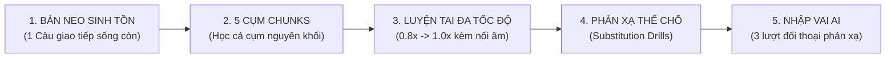

# Cẩm Nang Sư Phạm Nhận Thức & Thiết Kế Tài Liệu Tự Học Cùng AI (AI-Assisted Pedagogy & Learning Science Master Guide)

**Đơn vị chuẩn hóa**: Trung Tâm Nghiên Cứu & Tổng Hợp Học Thuật Antigravity  
**Phiên bản**: 2.0 (Tổng hợp và tích hợp từ chuỗi nghiên cứu thực nghiệm 2026)  
**Phạm vi áp dụng**: Tất cả các tác vụ thiết kế tài liệu học tập, soạn giáo án, gia sư AI tương tác, và tối ưu hóa phương pháp tự học (ngoại ngữ, toán học, lập trình, tư duy logic).

---

## MỤC LỤC TỔNG HỢP

1. [Trụ Cột 1: Nền Tảng Tiếp Thu Ngôn Ngữ (SLA) & Tối Ưu Học Thụ Động](#1-trụ-cột-1-nền-tảng-tiếp-thu-ngôn-ngữ-sla--tối-ưu-học-thụ-động)
2. [Trụ Cột 2: Sư Phạm Thiết Kế Ngược (Backward Design) & Khắc Phục Thất Bại Tạo Tài Liệu AI](#2-trụ-cột-2-sư-phạm-thiết-kế-ngược-backward-design--khắc-phục-thất-bại-tạo-tài-liệu-ai)
3. [Trụ Cột 3: Khung Thiết Kế Bài Học Sinh Tồn 15 Phút Cho Người Mới Bắt Đầu (A0–A1)](#3-trụ-cột-3-khung-thiết-kế-bài-học-sinh-tồn-15-phút-cho-người-mới-bắt-đầu-a0a1)
4. [Trụ Cột 4: Chiến Lược Giải Mã Điểm Nghẽn Bài Thi Chuẩn Hóa (TOEIC Reading 400+)](#4-trụ-cột-4-chiến-lược-giải-mã-điểm-nghẽn-bài-thi-chuẩn-hóa-toeic-reading-400)
5. [Trụ Cột 5: Hiệu Ứng Tách Biệt & Tích Hợp Biến Số (Isolated-Interacting Elements Effect)](#5-trụ-cột-5-hiệu-ứng-tách-biệt--tích-hợp-biến-số-isolated-interacting-elements-effect)
6. [Trụ Cột 6: Mô Hình Hóa Từng Bước Tư Duy (Cognitive Modeling & The Worked Example Effect)](#6-trụ-cột-6-mô-hình-hóa-từng-bước-tư-duy-cognitive-modeling--the-worked-example-effect)
7. [Trụ Cột 7: Kiến Trúc Ngôn Ngữ Dân Dã & Diệt Trừ Bệnh Dùng Từ Học Thuật (Plain Language)](#7-trụ-cột-7-kiến-trúc-ngôn-ngữ-dân-dã--diệt-trừ-bệnh-dùng-từ-học-thuật-plain-language)
8. [Bộ Master Prompts Sư Phạm Thực Chiến Dùng Ngay](#8-bộ-master-prompts-sư-phạm-thực-chiến-dùng-ngay)

---

## 1. Trụ Cột 1: Nền Tảng Tiếp Thu Ngôn Ngữ (SLA) & Tối Ưu Học Thụ Động

### 1.1. Các định luật nhận thức bất biến
* **Đầu vào hiểu được ($i+1$ - Stephen Krashen)**: Ngôn ngữ chỉ được tiếp thu khi người học hiểu được 85–95% ngữ cảnh ($i$), và chỉ có 5–15% là thông tin mới ($+1$). Nếu tài liệu đưa vào quá nhiều từ lạ ($i+5$), não bộ lập tức kích hoạt cơ chế tự vệ: **Sự choáng ngợp và đóng băng nhận thức**.
* **Bộ nhớ làm việc (Working Memory - Baddeley)**: Dung lượng xử lý có hạn (chỉ 4–7 chunks). Học tập hiệu quả đòi hỏi chuyển dịch tri thức từ Trí nhớ tường minh (Declarative Memory - vỏ não trước trán) sang Trí nhớ thủ tục tự động (Procedural Memory - hạch nền) thông qua rèn luyện có chủ đích (Deliberate Practice).
* **Giảm lo âu qua đối thoại AI (FLA Reduction - arXiv:2607.21887)**: Tương tác với AI tutor giúp giảm 43% chỉ số lo âu sợ nói ngoại ngữ (Foreign Language Anxiety) do môi trường tâm lý an toàn (Zero Judgment).

### 1.2. Phá bỏ ảo tưởng và 6 nguyên tắc tối ưu hóa học thụ động
* **Ảo tưởng nguy hại**: Bật file nghe tiếng Anh rồi đi ngủ với hy vọng não tự ngấm. Khoa học thần kinh khẳng định: **Cổng lọc thính giác (Auditory Gating)** của đồi thị (Thalamus) sẽ cắt đứt tín hiệu âm thanh phức tạp khi ngủ để bảo vệ não. Nghe thụ động vô thức 100% chỉ là tiếng ồn trắng (White Noise), hiệu suất bằng 0.
* **6 Nguyên tắc học thụ động đạt hiệu quả cao nhất**:
  1. *Ngưỡng hiểu tối thiểu (85–95%)*: Chỉ nghe thụ động những bài mà mắt đã đọc hiểu lời thoại trước đó.
  2. *Mồi chủ động (Active Priming)*: Dành 5–10 phút phân tích từ khóa và cấu trúc trước khi cắm tai nghe làm việc khác.
  3. *Thu hẹp chủ đề (Narrow Listening)*: Nghe 5–10 tập podcast khác nhau về cùng 1 chủ đề hẹp (ví dụ: công nghệ AI) để từ vựng tự nhiên lặp lại 15–20 lần trong các ngữ cảnh đa dạng.
  4. *Mã hóa kép (Dual Coding - Paivio)*: Kết hợp âm thanh với hình ảnh, cử chỉ hoặc video ngắn để tạo 2 lối mòn ghi nhớ trong não.
  5. *Củng cố trí nhớ khi ngủ (Targeted Memory Reactivation - TMR)*: Bật lại những âm thanh/từ khóa ngắn quen thuộc đã học trong ngày ở âm lượng rất nhỏ (dưới 40 dB) trong giai đoạn ngủ sóng chậm (Slow-Wave Sleep).
  6. *Cá nhân hóa theo sở thích (Personal Interest Hook)*: Tắm ngôn ngữ bằng chủ đề người học thực sự say mê, kích hoạt chất dẫn truyền thần kinh Dopamine.

---

## 2. Trụ Cột 2: Sư Phạm Thiết Kế Ngược (Backward Design) & Khắc Phục Thất Bại Tạo Tài Liệu AI

### 2.1. Giải mã 5 căn bệnh khiến tài liệu do AI tạo ra bị thất bại ("Không ra đâu vào đâu")
1. **Hồi quy về mức trung bình (Regression to the mean)**: AI tạo ra những bản tóm tắt nhạt nhòa, lý thuyết chung chung ai cũng biết nhưng không ai dùng được.
2. **Bức tường gạch đầu dòng (Bullet-point wall)**: Liệt kê dồn dập hàng chục ý kiến rời rạc, thiếu tính kết nối logic và không có mạch dẫn dắt.
3. **Mù vùng phát triển gần nhất (ZPD Blindness)**: Không phân tầng độ khó, đưa bài tập hoặc giải thích quá dễ hoặc quá khó đối với người học.
4. **Vắng bóng thiết kế ngược (Lack of Backward Design)**: Bắt đầu bằng việc nhồi nhét lý thuyết thay vì bắt đầu từ mục tiêu năng lực hành động cụ thể.
5. **Dễ dãi thiếu ma sát sư phạm (Lack of Pedagogical Friction)**: Đưa ra đáp án quá nhanh, không tạo thử thách (Desirable Difficulties) để kích thích não bộ người học tự động não suy nghĩ.

### 2.2. Khung Thiết Kế Ngược 3 Tầng (Backward Design - Wiggins & McTighe)
* **Tầng 1 (Xác định kết quả mong muốn)**: Người học sẽ LÀM ĐƯỢC GÌ cụ thể sau 15–30 phút? (Định lượng bằng hành động thực tế, không dùng từ chung chung như "hiểu biết", "nắm vững").
* **Tầng 2 (Bằng chứng đánh giá & Phản ví dụ)**: Thiết kế bài toán thực tế, câu hỏi tình huống và **Phản ví dụ (Non-examples)** để người học thấy rõ ranh giới giữa hiểu đúng và hiểu sai.
* **Tầng 3 (Kế hoạch học tập & Lý thuyết tối thiểu đủ dùng - MVT)**: Chỉ cung cấp lượng lý thuyết tối thiểu vừa đủ để giải quyết bài toán ở Tầng 2. Cắt bỏ 100% kiến thức râu ria, bác học.

### 2.3. Kỹ thuật Hai Đặc Vụ (Two-Agent Critic Pipeline)
* **Agent 1 (Drafter)**: Soạn bản thảo giáo án dựa trên mục tiêu năng lực hành động.
* **Agent 2 (Pedagogical Critic)**: Đóng vai giám khảo sư phạm khắt khe, kiểm tra 4 tiêu chí: Có bị nhồi lý thuyết suông không? Bài tập có quá dễ dãi không? Đã có phản ví dụ chưa? Có rào cản từ ngữ khó hiểu không? $\to$ Yêu cầu Agent 1 viết lại đến khi đạt chuẩn.

---

## 3. Trụ Cột 3: Khung Thiết Kế Bài Học Sinh Tồn 15 Phút Cho Người Mới Bắt Đầu (A0–A1)

### 3.1. Đặc thù tâm lý người mất gốc
* Bộ lọc cảm xúc (Affective Filter) rất cao: Sợ hãi, mặc cảm thất bại, sợ bị phán xét.
* Thói quen dịch nhẩm từng chữ sang tiếng Việt khiến tốc độ xử lý bị đơ.
* Quá tải bộ nhớ làm việc ngay khi nhìn thấy câu dài trên 6 từ.

### 3.2. Khung 5 khối sư phạm sinh tồn (15 phút / buổi)

1. **Khối 1: Bản neo sinh tồn (Survival Anchor - 2 phút)**: 1 tình huống thực tế nguy cấp và 1 câu nói chuẩn mực cứu nguy tức thì.
2. **Khối 2: 5 Cụm từ nguyên khối (Lexical Chunks - 3 phút)**: Tuyệt đối không dạy từ vựng đơn lẻ. Bắt buộc dạy theo cụm đi liền nhau (*I would like to...*, *Can I have a...*).
3. **Khối 3: Luyện tai đa tốc độ (Ear Tuning - 3 phút)**: Cung cấp phiên âm chuẩn, chỉ rõ hiện tượng nuốt âm/nối âm, nghe ở tốc độ chậm 0.8x rồi tăng lên tốc độ chuẩn 1.0x.
4. **Khối 4: Phản xạ thế chỗ (Substitution Drills - 4 phút)**: Giữ nguyên khung câu gốc, chỉ thay thế tân ngữ hoặc động từ để não quen với phản xạ ghép hình Lego.
5. **Khối 5: Nhập vai đối thoại sinh tồn cùng AI (Roleplay - 3 phút)**: AI đóng vai người bản xứ (nhân viên sân bay, bồi bàn), người học thực hành đối thoại 3 lượt để đạt được **Chiến thắng vi mô (Micro-Win)**.

---

## 4. Trụ Cột 4: Chiến Lược Giải Mã Điểm Nghẽn Bài Thi Chuẩn Hóa (TOEIC Reading 400+)

### 4.1. Bản chất 2 điểm nghẽn nhận thức
* **Sụp đổ ngưỡng bao phủ từ vựng 98% (Paul Nation)**: Người học cần biết nghĩa của tối thiểu 98% số từ trong bài đọc để hiểu nội dung mà không bị ngắt quãng. Điểm nghẽn lớn nhất trong TOEIC không phải từ hiếm mà là **Từ vựng công sở đa nghĩa** (*address, reflect, express, tentative, deliberate*).
* **Mù cú pháp trước 3 bẫy cấu trúc câu dài của ETS**:
  1. *Mệnh đề quan hệ rút gọn* (V-ing / V-ed chen ngang giữa Chủ ngữ và Động từ chính).
  2. *Cụm giới từ chêm vào dài dòng* (Prepositional phrase traps).
  3. *Cụm danh từ ghép công sở* (Noun compounds).

### 4.2. Khung Giàn Giáo 4 Tầng (Layered Scaffolding Pipeline)
1. **Tầng 1: Mở khóa từ vựng công sở then chốt**: Cung cấp nghĩa thực chiến trong văn cảnh doanh nghiệp kèm cụm Collocation bắt buộc.
2. **Tầng 2: Phẫu thuật X-Ray cấu trúc câu**: Tách rời thành phần cốt lõi:
   $$\text{[Chủ ngữ chính } S\text{]} \quad + \quad \text{\{Thành phần chen ngang\}} \quad + \quad \text{[Động từ chính } V\text{]} \quad + \quad \text{[Tân ngữ } O\text{]}$$
3. **Tầng 3: Câu hỏi chuẩn hóa ETS**: Cung cấp câu hỏi Part 5/6 tương ứng để người học áp dụng ngay.
4. **Tầng 4: Vạch trần bẫy nhận thức của 3 đáp án sai**: Giải thích tường tận người ra đề giăng bẫy gì ở từng đáp án sai để người học không bao giờ mắc lại.

---

## 5. Trụ Cột 5: Hiệu Ứng Tách Biệt & Tích Hợp Biến Số (Isolated-Interacting Elements Effect)

### 5.1. Cơ sở khoa học (John Sweller - Cognitive Load Theory)
* Khi một bài toán có **Độ tương tác biến số cao (High Element Interactivity)** — ví dụ: vừa phải dịch 3 từ mới lạ lẫm, vừa phải phân tích ngữ pháp câu phức — bộ nhớ làm việc bị quá tải 200%, dẫn đến tình trạng đoán mò.
* **Nguyên lý giải pháp**: Tách các biến số ra để não học thuần thục từng kỹ năng thành phần ở mức tải nhận thức thấp, sau đó mới tích hợp lại.

### 5.2. Hai cảnh báo sống còn
1. **Tránh bẫy Hẫng hụt chuyển giao (Transfer Deficit)**: Tuyệt đối không tách rời từ vựng và ngữ pháp theo kiểu "tháng này chỉ học ngữ pháp, tháng sau mới học từ vựng". Phải ghép nối ngay trong **Vòng lặp ngắn (Micro-Cycle) 30 phút**.
2. **Tránh bẫy học từ vựng đơn lẻ**: Tuyệt đối không học danh sách từ vựng trần trụi không có ngữ cảnh. Luôn học trong khung câu ngắn 5 chữ hoặc cụm Collocation.

### 5.3. Quy trình 3 bước: Tách — Luyện — Hợp
* **Bước 1 (Cô lập ngữ pháp bằng từ tiểu học)**: Luyện 5 câu ngữ pháp chỉ dùng từ vựng cực dễ (*car, clean, dog, eat...*). Não bộ dành 100% công suất để khóa chặt cấu trúc cú pháp.
* **Bước 2 (Cô lập từ vựng công sở trong câu 5 chữ)**: Luyện các từ vựng công sở mới trong khung câu tối giản (*They unanimously approved the plan*). Khóa chặt nghĩa và cụm đi kèm.
* **Bước 3 (Tích hợp vào đề thi thật ETS)**: Giải câu hỏi thi thật chứa cả cấu trúc ngữ pháp Bước 1 và từ vựng Bước 2. Học sinh xử lý chính xác chỉ trong 10–15 giây.

---

## 6. Trụ Cột 6: Mô Hình Hóa Từng Bước Tư Duy (Cognitive Modeling & The Worked Example Effect)

### 6.1. Phá bỏ "Lời nguyền tri thức" (The Curse of Knowledge)
* Chuyên gia nén kinh nghiệm thành phản xạ ngầm 0.2 giây. Giảng dạy theo kiểu đưa ngay đáp án và dịch nghĩa là biến việc học thành "làm xiếc".
* Cần biến quá trình tư duy vô hình thành **Bản đồ chỉ đường hữu hình (Visible Thinking / Cognitive Apprenticeship - Collins et al.)**.

### 6.2. Ba thành phần bất biến của mỗi bước tư duy chuẩn
1. **Điểm neo thị giác (Visual Trigger / Anchor)**: Mắt người giải nhìn vào từ ngữ hoặc chi tiết cụ thể nào đầu tiên trên trang giấy để kích hoạt bước này?
2. **Hành vi nhận thức cốt lõi (Core Cognitive Action)**: Bóc tách khung xương câu, nhận diện mẫu dạng bài, hay gạt bỏ thành phần rác gây nhiễu?
3. **Chặn bẫy tư duy ngộ nhận (Fallacy Avoidance)**: Chỉ đích danh 1 lỗi sai phản trực giác mà người mới hay mắc phải tại bước này.

### 6.3. Chu kỳ làm mờ giàn giáo (Faded Scaffolding)
* Tránh **Hiệu ứng đảo ngược chuyên môn (Expertise Reversal Effect - Kalyuga)** khi người học đã nắm vững kiến thức.
* Lộ trình 3 chặng:
  - *Chặng 1 (Tuần 1–2)*: Mô hình hóa 100% (Hiển thị đầy đủ Bước 1 $\to$ 4).
  - *Chặng 2 (Tuần 3–4)*: Bài tập điền khuyết (Bước 1–2 có sẵn, người học tự hoàn thiện Bước 3–4).
  - *Chặng 3 (Tuần 5 trở đi)*: Tự giải quyết độc lập trong 10–15 giây (4 bước đã hòa tan thành trực giác).

---

## 7. Trụ Cột 7: Kiến Trúc Ngôn Ngữ Dân Dã & Diệt Trừ Bệnh Dùng Từ Học Thuật (Plain Language)

### 7.1. Căn bệnh công nghệ của LLM
* **Thiên vị dài dòng và uy quyền trong RLHF (Verbosity & Authority Bias)**: Thói quen thích "nói chữ", dùng thuật ngữ hàn lâm để tỏ ra nguy hiểm và thông minh.
* **Mặc định kích hoạt CALP**: Tự động dùng văn phong sách giáo khoa đại học khi nhận lệnh "giải thích/soạn tài liệu".
* **Bệnh danh từ hóa (Nominalization)**: Biến động từ sinh động thành các cụm danh từ ghép phức tạp làm câu văn nghẹn đặc.

### 7.2. Khung 4 Kỹ Thuật Dân Dã Hóa
1. **Trần từ vựng cưỡng chế (Vocabulary Ceiling)**: Giới hạn từ ngữ tương đương trình độ đọc hiểu học sinh lớp 7. Câu văn không dài quá 18 từ.
2. **Nguyên lý Feynman & Mô hình C-R-A**: Mọi khái niệm bắt buộc đi qua: Ẩn dụ đời thường (Concrete) $\to$ Minh họa trực quan (Representational) $\to$ Khái niệm trừu tượng (Abstract).
3. **Danh sách đen cấm từ (Negative Blacklist)**: Cấm tiệt các từ Hán-Việt rườm rà (*nội hàm, khả biến, tương liên, tương hỗ, hàm thụ, chuẩn tắc, quy nạp...*) và các câu đệm sáo rỗng.
4. **Kiến trúc giải nghĩa 2 tầng (Dual-Layer)**: Tên gọi thuần Việt tượng hình đi trước, thuật ngữ học thuật để trong ngoặc sau.

---

## 8. Bộ Master Prompts Sư Phạm Thực Chiến Dùng Ngay

### 8.1. Master Prompt 1: Tạo Bộ Bài Tập Tách — Luyện — Hợp (TOEIC / Luyện thi)
```markdown
Bạn là Chuyên gia Thiết kế Giáo trình theo Lý thuyết Tải nhận thức (Cognitive Load Theory) và Hiệu ứng tách biệt biến số (Isolated-Interacting Elements Effect).

Nhiệm vụ: Hãy tạo một bộ bài học 30 phút theo đúng quy trình TÁCH - LUYỆN - HỢP cho:
- Chủ điểm ngữ pháp: [TÊN NGỮ PHÁP, ví dụ: Mệnh đề quan hệ rút gọn bị động V-ed]
- Nhóm từ vựng công sở: [CHỦ ĐỀ TỪ VỰNG, ví dụ: Hợp đồng & Pháp lý: deliberate, tentative, terminate...]

RÀNG BUỘC SƯ PHẠM BẮT BUỘC:
- BƯỚC 1 (CÔ LẬP NGỮ PHÁP): 5 câu trắc nghiệm 4 đáp án. BẮT BUỘC chỉ dùng từ vựng tiểu học (car, dog, clean, apple...). Người học không cần dịch từ điển, tập trung 100% vào cấu trúc câu.
- BƯỚC 2 (CÔ LẬP TỪ VỰNG): 5 câu ngắn tối đa 6-8 chữ. Ngữ pháp cực kỳ đơn giản (S + V + O). Tập trung làm nổi bật ý nghĩa của từ vựng mục tiêu và cụm Collocation.
- BƯỚC 3 (TÍCH HỢP ĐỀ THI THẬT): 3 câu trắc nghiệm chuẩn format ETS TOEIC Part 5, kết hợp đúng ngữ pháp Bước 1 và từ vựng Bước 2. Có đáp án kèm X-Ray bóc tách cấu trúc câu.
```

### 8.2. Master Prompt 2: Giải Thích Từng Bước Mô Hình Hóa Tư Duy
```markdown
Bạn là Chuyên gia Sư phạm Nhận thức am hiểu sâu sắc Cognitive Modeling và The Worked Example Effect.

Nhiệm vụ: Hướng dẫn tôi giải quyết câu hỏi / bài toán sau:
[DÁN ĐỀ BÀI HOẶC BÀI TOÁN VÀO ĐÂY]

RÀNG BUỘC BẮT BUỘC:
Tuyệt đối KHÔNG đưa đáp án cụt lủn hoặc chỉ dịch nghĩa. BẮT BUỘC bộc lộ tư duy chuyên gia theo 4 bước:
- Bước 1 (Điểm neo thị giác): Mắt nhìn vào chữ/dấu hiệu nào đầu tiên trong đề bài để định hướng?
- Bước 2 (Phẫu thuật khung xương): Bóc tách cấu trúc ngữ pháp cốt lõi (S - V - O) hoặc dữ liệu chính; chỉ rõ thành phần rác gây nhiễu cần gạt bỏ.
- Bước 3 (Áp dụng quy tắc & Chặn bẫy tư duy): Điền cái gì và tại sao? Chỉ đích danh 1 bẫy sai lầm phổ biến người mới hay mắc phải.
- Bước 4 (Kỹ thuật loại trừ & Chốt hạ): Cách liếc 4 đáp án để chốt trong 3 giây và lý do loại bỏ các đáp án còn lại.
```

### 8.3. Master Prompt 3: Giải Thích Theo Nguyên Lý Feynman & Plain Language
```markdown
Bạn là Chuyên gia Giảng dạy theo Phương pháp Feynman và Ngôn ngữ Đời thường (Plain Language Specialist).

Nhiệm vụ: Hãy giải thích khái niệm sau cho người mới bắt đầu:
[DÁN ĐIỂM NGỮ PHÁP / KHÁI NIỆM KỸ THUẬT VÀO ĐÂY]

RÀNG BUỘC NGÔN NGỮ:
1. TRẦN TỪ VỰNG LỚP 7: Chỉ dùng ngôn ngữ trong sáng, tự nhiên như hai người bạn ngồi uống trà đá. Tuyệt đối không dùng văn phong sách giáo khoa đại học. Mỗi câu không dài quá 18 từ.
2. NGUYÊN TẮC C-R-A: Tuyệt đối KHÔNG đưa định nghĩa trừu tượng lên đầu. BẮT BUỘC mở đầu bằng 1 hình ảnh đời thường gần gũi (nấu ăn, đi chợ, xếp hình Lego, tập lái xe) rồi dùng hình ảnh đó để giải thích bản chất.
3. DANH SÁCH ĐEN: Cấm tiệt các từ Hán-Việt rườm rà (nội hàm, khả biến, tương liên, tương hỗ, hàm thụ, chuẩn tắc, quy nạp, tiên quyết) và cấm các câu đệm sáo rỗng.
4. KIẾN TRÚC 2 TẦNG: Thuật ngữ chuyên ngành phải đặt tên bằng từ tiếng Việt dân dã trước, tên tiếng Anh để trong ngoặc sau.
```
